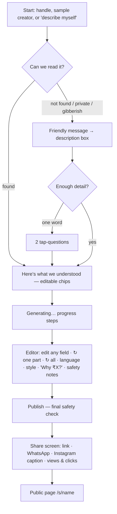

# AI Storefront Generator: Decision Doc

**Rahul Wagh** · PM take-home for SuperProfile · Live: https://storefront-ai-eight.vercel.app · Code: https://github.com/rwagh831-pm/storefront-ai

---

## 1. The problem as I understand it

SuperProfile earns when creators **sell**: a subscription plus 5% of each sale. A creator who signs up and leaves the store empty earns the creator ₹0 and SuperProfile close to ₹0. So the "empty store" is a **revenue and activation leak**, not just a UX problem.

The brief names three missing skills: **what to sell, how to price, how to write**. I added a fourth: **confidence**. "A store I'm proud to share" means the creator must believe the price won't embarrass them. That's why every price shows **"Why ₹X?"**

The real job is not "generate a page". It is **blank → published → shared**. A store nobody visits still earns ₹0, so the flow ends at a share screen, not at "Publish".

**Assumptions**
- Most new creators set up on a phone, in short sessions → a mobile-first, single-column flow, with the draft auto-saved on the device.
- Creators trust suggestions they can see the reason for → a visible pricing rationale and safety notes.
- Price bands are **my assumptions** from Indian reference prices (₹99 ebooks, ~₹500 online courses, ₹1–2K gym months or consultations). They are **not** SuperProfile data, and the first thing I would replace (§9).
- Live Instagram access is out of scope for a prototype (see §5).

**Personas.** I kept both personas but routed them differently. **Micro-creators** (5K–100K) enter a handle. **Experts without an audience** describe themselves; the AI asks up to two tap-questions when the input is thin. I did not build YouTube input, because Instagram is SuperProfile's link-in-bio home and adding a second source doubled the edge cases.

## 2. User flow

**Main-screen alternatives I considered and rejected**

| Alternative | Why rejected |
|---|---|
| **One-shot generation** (input → finished store, no confirm step) | Faster by ~10 seconds, but one wrong guess (e.g. "fitness" read as gym bodybuilding) ruins the whole store, and the creator doesn't know why. The confirm step makes the AI's understanding visible and fixable *before* we spend a generation. |
| **Chat-style builder** (AI asks questions in a conversation) | Feels friendly, but it's slow on a phone, hard to scan, and hard to edit later. Our creator sets up "between other work". |
| **Side-by-side editor + live preview** | Doesn't fit a 375px screen. I used an **Edit / Preview toggle** instead. |

## 3. Key decisions and trade-offs

| Decision | Why | Trade-off accepted |
|---|---|---|
| **AI writes, code enforces.** Prices are clamped to bands; safety rules are checked in code | LLMs are good at copy and inconsistent with numbers and rules. The creator must never see ₹37 or a "guaranteed returns" product | The bands are only as good as my assumptions |
| **Price ladder:** entry < ₹500 → core → premium (1:1 / cohort) | A cheap first purchase lowers buyer risk; a premium item captures the creator's most valuable time | Some niches may not need three tiers; the creator can remove one (minimum 2) |
| **"Here's what we understood" step** | Handles vague input; builds trust; costs one cheap call | Adds one screen |
| **Claude Haiku 5.5** (fallback: Haiku 4.5) | ~₹0.2 per store, 10–20s generation; quality was good in English, Hinglish and Hindi in testing | A larger model might write better copy at about 20× the cost |
| **Sample Instagram profiles instead of scraping** | Scraping is blocked from cloud servers and against platform terms. Samples let me demo real signals (bio, captions, comment demand) honestly | Reviewers can't try their own handle; they get the fallback (which is itself an edge-case demo) |
| **No login; an edit token kept in the browser** | Login is a drop-off point; the brief says auth only if needed | Editing works only from the same browser |
| **Edit form, not inline WYSIWYG** | Large, reliable inputs on a phone keyboard | Less "magical" than editing directly on the page |

## 4. What I deliberately did NOT build

- **Payments / checkout:** SuperProfile already has them; "Get it" shows a placeholder and counts the click.
- **Login / accounts:** not needed to prove the value; it adds friction.
- **Real Instagram scraping:** ToS risk and blocked IPs. Production should use SuperProfile's **existing Instagram connection from Auto-DM**.
- **Image or cover generation, custom domains, multiple themes per section:** these look nice but don't move "publish in the first session".
- **Analytics dashboard:** only views/clicks on the share screen, plus a logged time-to-publish event.
- **Per-user limits on AI calls:** analytics are rate-limited, but AI generation is not yet (§9).

## 5. How the AI works

**Two steps, both with structured output** (JSON validated against Zod schemas, never free text):

1. **Understand** (`/api/profile`): input is the sample Instagram payload (bio, follower count, recent captions with likes and comments) or the creator's description and answers. Output: niche, niche group, audience, strengths, **demand signals** (e.g. "210 comments asking for a plan"), credentials, risk flags, and follow-up questions if the input is too thin.
2. **Generate** (`/api/generate`): the prompt includes the profile, **this creator's price bands per format**, the safety policy and the language rule. Output: tagline, bio, 2–4 products (format, title, who it's for, description, deliverables, price, price reason), an Instagram caption, and safety notes. Regenerating **one part** sends the rest of the store as context, so the new idea doesn't duplicate the others.

**Prompt principles:** use only facts from the input (no invented credentials or testimonials); be specific; compare prices to things Indian buyers already pay for; write Hinglish the way creators write on Instagram.

**Quality control (in code, after the model):**
- Schema validation → on failure, retry on the fallback model.
- **Price enforcement:** clamp to the band and round to ₹x99; if adjusted, the reason says so.
- **Safety, 3 layers:** (1) rules scan the creator's own content and flag it to the model; (2) every generated product is scanned, then *blocked* items are replaced or removed, with a note shown to the creator; (3) **publish re-checks the final text**, because creators can type anything while editing.
- Policy covers: steroids and diet pills, counterfeit ("first copy") goods, leaked papers, betting tips (blocked); guaranteed returns or stock tips (SEBI), cure claims, "lose 10 kg in 15 days", guaranteed astrology outcomes (reworded).

**Break-testing:** I attacked the live app with 58 hostile inputs (prompt injection, a counterfeit-goods seller, script injection in titles, 62 KB inputs, filter evasion such as "g u a r a n t e e d" or "st3roid", fake click floods, store-link hijacking, parallel load). The first run found 9 issues; all are fixed: text is normalised before safety checks (plus Hindi/Hinglish phrases), inputs are size-capped, Tamil/Bengali are no longer mistaken for gibberish, pasted Instagram links work, blank names are rejected, analytics are rate-limited and only count real stores, a double-tap publish returns the same store, and store links are case-insensitive. Known limit: keyword rules can't catch every paraphrase; an LLM moderation pass at publish is next (§9).

**Failure handling:** cheap input checks before any LLM call (empty, gibberish, invalid handle) → 25s timeout per model → fallback model → a friendly "try again" with all inputs kept → the draft is auto-saved in the browser → friendly pages for unknown store links and unexpected errors. The creator never sees a broken page.

## 6. Success metrics

| Metric | Target | How to measure |
|---|---|---|
| **Primary: % of new sign-ups who publish a store in their first session** | **About 2× the current baseline** (e.g. if 15% publish in session one today, aim for ~30%). It removes three blockers at once; I'd validate the size in the test | A/B test on new India sign-ups (50/50) for 2 weeks; event `store_published` with `session_id` = signup session |
| **Speed: median time from first input to first publish** | **Under 5 minutes** for the AI path (instrumented in the prototype: `metrics:time_to_publish_ms`) | Log `flow_started` → `store_published` timestamps |
| **Guardrail: % of AI stores with ≥1 product click in 7 days**, plus **% of AI prices edited by creators** | Clicks should not be lower than manual stores; a high edit rate on price = wrong bands | Clicks are already tracked per store; log edits per field |

The north-star outcome is **first sale within 14 days**, but it's too slow and noisy for a 2-week test, so it's a secondary readout.

## 7. Launch thought

Make **"Build my store with AI"** the default empty-store state for new sign-ups in India, rolled out to **10% → 50% → 100%** behind the A/B test. Pre-fill from the creator's connected Instagram (already used by Auto-DM). Launch content: "I built my store in 2 minutes" Reels with micro-creators in 3–4 niches (fitness, finance education, exam prep, cooking), in Hinglish. The share screen's ready-made caption is itself a growth loop: every published store advertises SuperProfile.

## 8. How I used AI coding tools

I used **Claude Code** as a pair programmer and tutor. I owned the product decisions: personas, the flow, the price-band table and ladder, the safety categories, what to cut, and the metrics. Claude Code scaffolded the Next.js app (`create-next-app`), wrote most of the code to my specs, ran tests in a browser at phone size (sample creators, all edge cases, a publish-time safety block), and caught a Next.js 16 build issue before deploy. I reviewed each part and verified the live site end to end. No UI kit was used.

## 9. With two more weeks

1. **Real profile data:** use SuperProfile's Instagram connection (from Auto-DM) or the Instagram Graph API; then measure how much real signals improve the store versus description only.
2. **Replace assumed price bands with SuperProfile sales data** (median price and conversion by niche × format × follower tier); A/B test the suggested price against ±30%.
3. **Eval set:** 50 creator profiles across niches and languages, scored for specificity, price sanity and safety; run on every prompt change.
4. **One-click import into SuperProfile** as real draft products (their MCP server and API).
5. **Second-provider fallback** (e.g. Gemini), an **LLM moderation pass at publish** (catches paraphrased claims keyword rules miss), and per-user rate limits on AI calls.
6. A cover image per offer, and real checkout via SuperProfile.
